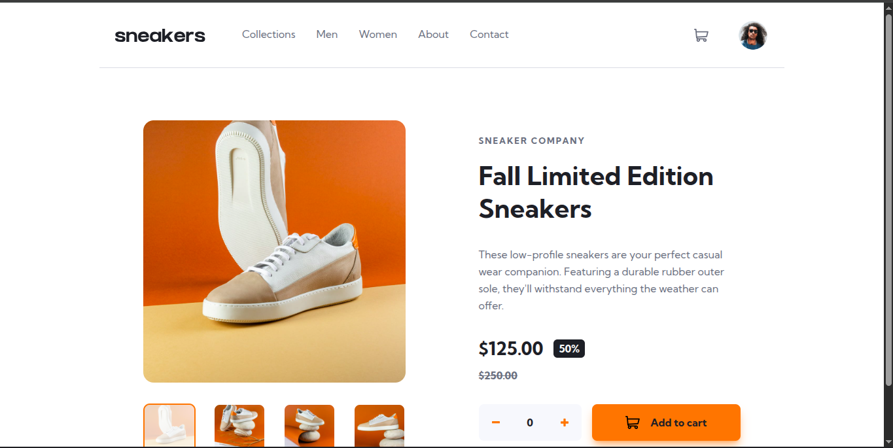

# E-commerce Product Page

A responsive sneakers product page with an image gallery, a lightbox, and a working cart, built as a solution to a [Frontend Mentor](https://www.frontendmentor.io/challenges/ecommerce-product-page-UPsZ9MJp6) challenge. The cart state is managed with Context API and useReducer.

## Overview

The page has a header with a menu, a cart button, and an avatar, followed by the product images and the product details. You choose a quantity, add the sneakers to the cart, and review or delete them in the cart dropdown. The layout changes between mobile and desktop screen sizes, and every link and button has a hover state.

## Preview



## Features

- Responsive layout for mobile and desktop screens
- Hamburger menu on mobile that opens and closes
- Image gallery with thumbnails on desktop and arrow buttons on mobile
- Lightbox gallery that opens from the main image, with arrows and thumbnails
- Lightbox closes with the Esc key, and the keyboard focus stays inside it
- Quantity picker that never goes below zero
- Add to cart button that adds the chosen quantity to the same cart item
- Cart dropdown with a badge showing the total number of items
- Delete items from the cart and see the total price
- Discounted price calculated from the original price and the discount
- Hover states on all links and buttons
- Custom colors and font set up in the Tailwind theme
- Built with strict TypeScript typing throughout

## Tech Stack

- [React](https://react.dev/)
- [TypeScript](https://www.typescriptlang.org/)
- [Tailwind CSS](https://tailwindcss.com/)
- [Vite](https://vitejs.dev/)

## Getting Started

Clone the repository and install dependencies:

```bash
git clone https://github.com/Zikra-S/E-commerce-product-page.git
cd E-commerce-product-page
pnpm install
pnpm dev
```

The app will be available at `http://localhost:5173`.

## Project Structure

```
src/
├── assets/images/     # Logo, icons, avatar, and product photos
├── components/
│   ├── header.tsx         # Logo, links, cart button with badge, and avatar
│   ├── mobileMenu.tsx     # Side menu for mobile screens
│   ├── cartPanel.tsx      # Cart dropdown with items and checkout button
│   ├── gallery.tsx        # Main image with thumbnails or mobile arrows
│   ├── thumbnails.tsx     # Row of small product images
│   ├── lightbox.tsx       # Popup gallery with arrows and thumbnails
│   └── productInfo.tsx    # Product details, quantity picker, and add button
├── context/
│   └── cartContext.tsx    # Cart reducer, actions, and provider
├── data/
│   └── product.ts         # Product details, price, and image list
├── App.tsx            # Puts the header and the product together
├── index.css          # Tailwind import, theme colors, and font
└── main.tsx           # App entry point with the cart provider
```